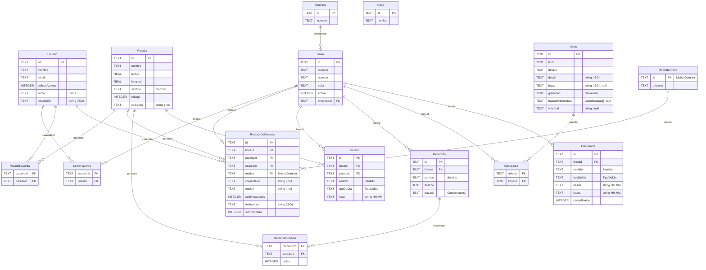

# Base de datos — diagrama

> Base sqlite local de Paran.
> 15 tablas · 17 relaciones. Tipos de columna de sqlite; el comentario es el tipo de TypeScript.

## Cómo leerlo

- `||--o{`: uno a muchos (la tabla de la izquierda es la "1", la de la derecha la "N"). El texto es la columna FK.
- `PK` clave primaria · `FK` clave foránea. Las tablas sin PK simple usan PK compuesta:
  - `LineaFavorita`: (usuarioId, lineaId)
  - `ParadaFavorita`: (usuarioId, paradaId)
  - `RecorridoParada`: (recorridoId, orden)
  - `AvisoLinea`: (avisoId, lineaId)
- `TEXT` con `Sentido`, `TipoDeDia`, `Gravedad` o `Tema` lleva un `CHECK` con los valores permitidos. `ReporteDeDemora.motivo` es FK a la tabla `MotivoDemora`.

## Propiedades del PRD que no son columnas

Están en las interfaces de `src/tipos/`, pero en sqlite se arman con otra tabla:

- `Usuario.lineasFavoritas` (string[]) → tabla LineaFavorita
- `Usuario.paradasFavoritas` (string[]) → tabla ParadaFavorita
- `Parada.lineaIds` (string[]) → se calcula con RecorridoParada
- `Linea.empresa` (string) → JOIN con Empresa.nombre por empresaId
- `Linea.recorridos` (Recorrido[]) → tabla Recorrido
- `Recorrido.paradaIds` (string[]) → tabla RecorridoParada
- `Aviso.lineaIds` (string[]) → tabla AvisoLinea
